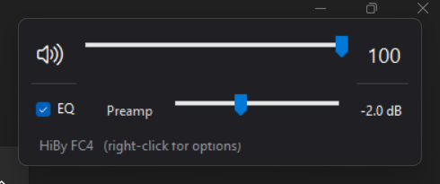

# FC4 Control

A small Windows tray app and desktop widget for the **HiBy FC4** USB DAC.



## Why

On Windows the HiBy FC4 ignores the system volume: the speaker icon, the keyboard volume keys and the
volume slider all do nothing, and the only way to change the level is the buttons on the DAC.

FC4 Control fixes that and adds quick access to the DAC's EQ:

- **Windows volume works again.** The Windows speaker icon, keyboard volume keys and mouse wheel change
  the sound on the FC4.
- **Desktop widget or tray popup.** Volume, mute, EQ on/off and preamp in one small panel.
- **EQ presets.** Save the 10-band PEQ that is in the DAC and switch between saved presets in two clicks.
- **Preamp** from -9 to +9 dB.
- No installer, no drivers, no background services. One small `.exe`.

## How it works

- **Volume:** the FC4 accepts the Windows hardware volume but does nothing with it. FC4 Control watches the
  Windows volume of the FC4 and applies the same level to every app playing on it (the Windows volume mixer).
  The DAC's own volume stays where you set it with its buttons, so set that to the loudest level you need.
- **EQ and preamp:** sent to the DAC over its HID control channel, the same way HiBy's own PC app does.
  The message format is documented in [docs/PROTOCOL.md](docs/PROTOCOL.md).

## Install

1. Download `FC4Control.exe` from [Releases](../../releases) and put it in its own folder,
   for example `C:\Users\<you>\Tools\FC4Control`.
2. Run it. A speaker icon appears in the notification area next to the clock.
3. Optional: to start it with Windows, press `Win + R`, type `shell:startup`, and put a shortcut
   to `FC4Control.exe` in that folder.

Requires Windows 10 or 11 (uses .NET Framework 4, which is part of Windows).

The `.exe` is not code-signed, so Windows SmartScreen may warn before the first run. Each release lists the
file's SHA-256; you can check your download with `Get-FileHash FC4Control.exe` in PowerShell, or build it
yourself from the source (see below).

## Use

- **Left-click** the tray icon: open the volume panel.
- **Right-click** the tray icon or the widget: menu.
  - **Show on desktop**: keep the panel on the desktop as a widget. Drag it by its background.
  - **Always on top**: keep the widget above other windows.
  - **EQ presets**: apply a saved preset, save the current EQ, open the presets folder.
- Click the **speaker symbol** to mute.

On first start FC4 Control saves the EQ that is in your DAC as `presets\Original (backup).txt`,
so you can always go back to it.

> **Careful with presets from other people.** A preset is a small text file. FC4 Control refuses any value
> outside the DAC's limits, but inside those limits a preset can still be very loud (for example every band
> and the preamp at +9 dB). Read a shared preset before you apply it, and turn the volume down first.

### Tray icon

Windows may hide the icon under the `^` arrow next to the clock. To keep it visible, drag it onto the taskbar,
or turn on **FC4Control** in *Settings → Personalization → Taskbar → Other system tray icons*.

### Command line

```
FC4Control.exe --set 40            set the volume to 40 %
FC4Control.exe --up | --down       change the volume by 2 %
FC4Control.exe --mute              mute or unmute
FC4Control.exe --preset <name>     apply a saved EQ preset
FC4Control.exe --save-preset <name>
FC4Control.exe --eq                print the EQ that is in the DAC
FC4Control.exe --list              show the FC4 and the apps playing on it
```

`--set`, `--up`, `--down` and `--mute` control the copy that is already running. In CMD the prompt can come
back before `--eq` or `--list` finish printing, because FC4Control is a window app; PowerShell waits for it.

## Build from source

No Visual Studio needed. Run `build.cmd`; it uses the C# compiler that ships with Windows
(`%WINDIR%\Microsoft.NET\Framework64\v4.0.30319\csc.exe`).

## Limits

- The DAC's gain, digital filter and its own volume can't be controlled from the PC. Its HID channel only
  exposes the PEQ, preamp and PEQ on/off (see [docs/PROTOCOL.md](docs/PROTOCOL.md)).
- Apps that use WASAPI exclusive mode or ASIO bypass the Windows mixer, so the volume control does not
  affect them.
- Tested with one HiBy FC4 (firmware `FC4II v1.1`) on Windows 11. Other HiBy dongles may use the same
  protocol, but that is untested.

## Disclaimer

Not affiliated with or endorsed by HiBy. The EQ and preamp features write settings to your DAC.
They use the same messages as HiBy's own app and have worked fine in testing, but use them at your own risk.

## License

[MIT](LICENSE)

---

## بالعربي

برنامج صغير لويندوز يخلّي **وليوم الويندوز يشتغل مع داك HiBy FC4**، لأن الداك يتجاهل وليوم النظام.
فيه ويدجت لسطح المكتب، وتحكم بالـ EQ والـ Preamp، وحفظ إعدادات EQ والتبديل بينها.

نزّل `FC4Control.exe` من صفحة Releases وشغّله، وتطلع أيقونة سماعة جنب الساعة.
ضغطة يمين عليها وفعّل **Show on desktop** عشان يصير ويدجت على سطح المكتب.
